# Computer Networks Project — Phase 2 Final Implementation Report
## Private Network Service Platform: Harden, Recover & Troubleshoot

**Course:** Computer Networks (Laboratory Project)  
**Phase:** Phase 2 — Resilience, Service Isolation, DNS Failover & Controlled Failure Diagnosis  
**Evaluation:** Review 2 (50 Marks)  
**Date of Submission / Review:** November 2026  
**Repository:** `https://github.com/mishrasarthak08/cn_project_PS3.git`  

---

### Team Members & Node Allocation

| Node | Student Name | Role | Primary Phase 2 Ownership | Services & Ports | LAN IP Address | MAC Address |
|---|---|---|---|---|---|---|
| **Mac 1** | **Sarthak Mishra** (Lead) | Primary DNS + Controller + Test Client | **Ext B** (DNS TTL Cutover), **Ext E** (DNS Cutover), **Ext F** (Triage Lead), Report Lead | `dnsmasq` (`53`), Controller | `10.7.0.226` | `92:82:a9:6f:7c:8f` |
| **Mac 2** | **Preetish Ubhrani** | Edge Reverse Proxy & Load Balancer | **Ext D** (HA Failover & Self-Healing Tuning), **Ext C** (Edge Firewall Verification) | `nginx` (`8443`), TLS 1.3 | `10.7.16.162` | `2e:3e:87:1c:cc:ab` |
| **Mac 3** | **Shitanshu Tiwari** | Backend A Service | **Ext C** (macOS `pf` Firewall Isolation on port 3001), **Ext E** (Standby Edge Host) | Python REST (`3001`) | `10.7.2.192` | `10:9f:41:c2:d9:37` |
| **Mac 4** | **Shane** | Backend B Service + 2nd Client | **Ext A** (Backup DNS Server on port 53), **Ext C** (macOS `pf` Firewall on port 3002) | Python REST (`3002`), `dnsmasq` (`53`) | `10.7.6.77` | `9e:f3:a4:24:4f:f7` |

---

## 1. What Changed from Phase 1

Phase 2 builds directly upon our Phase 1 baseline without rebuilding the application layer. The primary architectural changes focus on **high availability, fault tolerance, zero-trust perimeter security, and automated recovery**:

```mermaid
flowchart TD
    subgraph Clients ["Client Machines (Mac 1 & Mac 4)"]
        CL["Dual Resolvers (/etc/resolver/team1.test)<br/>nameserver 10.7.0.226<br/>nameserver 10.7.6.77"]
    end
    subgraph DNS ["DNS Redundancy (Extension A & B)"]
        D1["Mac 1: Primary dnsmasq (53)<br/>TTL: 30s"]
        D2["Mac 4: Backup dnsmasq (53)<br/>TTL: 30s"]
    end
    subgraph Edge ["Edge Tier (Extension D & E)"]
        E1["Mac 2: Nginx Reverse Proxy (8443)<br/>TLS 1.3 Termination<br/>proxy_next_upstream error timeout 502 503<br/>fail_timeout=5s, connect_timeout=2s"]
    end
    subgraph Backends ["Isolated Backend Tier (Extension C)"]
        B1["Mac 3: Backend A (:3001)<br/>macOS PF Anchor: com.apple/cn_backend_isolation<br/>ALLOW: Mac 2 (10.7.16.162) | BLOCK: LAN"]
        B2["Mac 4: Backend B (:3002)<br/>macOS PF Anchor: com.apple/cn_backend_isolation<br/>ALLOW: Mac 2 (10.7.16.162) | BLOCK: LAN"]
    end

    CL -.->|"Primary Query"| D1
    CL -.->|"Automated Fallback"| D2
    CL ==>|"HTTPS :8443"| E1
    E1 -->|"HTTP :3001 (Allowed)"| B1
    E1 -->|"HTTP :3002 (Allowed)"| B2
    CL -.-x|"Direct Access Blocked by PF"| B1
    CL -.-x|"Direct Access Blocked by PF"| B2
```



1. **DNS Architecture (Phase 1 $\rightarrow$ Phase 2):**
   * *Phase 1:* Single point of failure with only one DNS server on Mac 1.
   * *Phase 2:* Dual-resolver architecture. Shane (Mac 4) runs a secondary `dnsmasq` resolver with identical records pointing to Preetish's Edge (`10.7.16.162`). Client machines list both nameservers in `/etc/resolver/team1.test`.
   * *TTL Control:* DNS record TTL was explicitly lowered from 300s to **30s** (`local-ttl=30`) to demonstrate client caching expiration and rapid migration.
2. **Reverse Proxy & Resilience Tuning:**
   * Nginx upstream configuration hardened with passive circuit-breaking directives:
     ```nginx
     upstream project_backends {
         server 10.7.2.192:3001 max_fails=1 fail_timeout=5s;
         server 10.7.6.77:3002 max_fails=1 fail_timeout=5s;
     }
     proxy_connect_timeout 2s;
     proxy_next_upstream error timeout http_502 http_503 http_504;
     proxy_next_upstream_tries 2;
     ```
3. **Service Isolation (Zero Trust at Layer 4):**
   * Implemented macOS Packet Filter (`pf`) rules nested under anchor `com.apple/cn_backend_isolation`. Backend ports 3001 and 3002 reject all incoming TCP SYN packets with TCP RST (`block return`) unless the source IP is the Edge proxy (`10.7.16.162`) or loopback (`127.0.0.1`).

---

## 2. Resilience Tests and Results (The 3 Core Drills)

---

### Drill 1: Backup DNS Resolver Failover (Extension A)

#### Objective
Prove that client machines transparently fall back to the backup DNS resolver when the primary DNS service is terminated, with zero dropped client queries.

#### Execution & Captured Evidence

**1. Primary DNS Service Stopped on Mac 1:**
```bash
$ pkill -9 -f dnsmasq
```

**2. Direct Query to Primary DNS (Times Out):**
```text
$ dig +time=2 +tries=1 @10.7.0.226 app.team1.test

; <<>> DiG 9.10.6 <<>> +time=2 +tries=1 @10.7.0.226 app.team1.test
;; connection timed out; no servers could be reached
```

**3. Direct Query to Backup DNS (Answers Successfully):**
```text
$ dig +time=2 +tries=1 @10.7.6.77 app.team1.test

;; QUESTION SECTION:
;app.team1.test.			IN	A

;; ANSWER SECTION:
app.team1.test.		30	IN	A	10.7.16.162

;; Query time: 11 msec
;; SERVER: 10.7.6.77#53(10.7.6.77)
```

**4. Operating System Resolver Fallback (Non-Cached Fresh Proof Query):**
To eliminate local `mDNSResponder` cache hits, a dynamically generated unique hostname was resolved:
```bash
$ name="proof-1795459579.app.team1.test"
$ dscacheutil -q host -a name "$name"
name: proof-1795459579.app.team1.test
ip_address: 10.7.16.162
```

**5. Backup Server Access Log Confirmation (Mac 4):**
On Shane's Mac (`10.7.6.77`), the exact proof query from client `10.7.0.226` was logged in real time:
```text
query[A] proof-1795459579.app.team1.test from 10.7.0.226
reply proof-1795459579.app.team1.test is 10.7.16.162
```

**Result:** **100% PASS** — Automated resolver fallback confirmed by query response, system resolution, and backup server audit logs.

---

### Drill 2: High-Availability Failover & Self-Healing (Extension D)

#### Objective
Prove that if a backend application instance crashes, the Nginx reverse proxy redirects traffic to the surviving backend without dropping requests or returning `502 Bad Gateway`, and automatically resumes load balancing when the backend recovers.

#### Execution & Captured Evidence

**1. Baseline Load Balancing Across Both Backends:**
```bash
$ for i in {1..4}; do curl -s -k https://app.team1.test:8443/api/status | grep -o '"backend": "[AB]"'; done
"backend": "A"
"backend": "B"
"backend": "A"
"backend": "B"
```

**2. Backend A Stopped on Mac 3 (`./macs/mac3-shitanshu/stop.sh`):**
Client executes consecutive requests during failure:
```bash
$ for i in {1..4}; do curl -s -k https://app.team1.test:8443/api/status; echo ""; done
{"backend": "B", "owner": "Shane", "status": "ok"}
{"backend": "B", "owner": "Shane", "status": "ok"}
{"backend": "B", "owner": "Shane", "status": "ok"}
{"backend": "B", "owner": "Shane", "status": "ok"}
```

**3. Edge Proxy Log Evidence (`nginx-access.log` on Mac 2):**
```text
127.0.0.1 [...] "GET /api/status HTTP/2.0" 200 upstream=10.7.2.192:3001, 10.7.6.77:3002 backend=B rt=1.149
127.0.0.1 [...] "GET /api/status HTTP/2.0" 200 upstream=10.7.6.77:3002 backend=B rt=0.040
127.0.0.1 [...] "GET /api/status HTTP/2.0" 200 upstream=10.7.6.77:3002 backend=B rt=0.041
```
*Analysis:* On the first request following the crash, Nginx attempted to connect to Backend A, encountered a connection refusal, triggered `proxy_next_upstream`, and completed the request via Backend B in 1.149s. Backend A was marked down for `5s` (`fail_timeout`), so subsequent requests routed to Backend B instantly with 40ms response time.

**4. Backend A Restarted & Automated Self-Healing:**
```bash
# Shitanshu runs start.sh on Mac 3
$ for i in {1..6}; do curl -k -s https://app.team1.test:8443/api/status | grep -o '"backend": "[AB]"'; sleep 0.2; done
"backend": "A"
"backend": "B"
"backend": "A"
"backend": "B"
"backend": "A"
"backend": "B"
```
After the 5-second `fail_timeout` expired, Nginx re-probed Backend A, detected HTTP 200, and immediately restored 50/50 round-robin balancing without restarting Nginx.

**Result:** **100% PASS** — Zero dropped requests; self-healing fully verified.

---

### Drill 3: Service Isolation via macOS `pf` Firewall (Extension C)

#### Objective
Enforce defense-in-depth by restricting direct LAN access to backend ports (3001 and 3002) so that only the Edge Proxy (`10.7.16.162`) can communicate with backends. Direct client access must be rejected.

#### Execution & Captured Evidence

**1. Firewall Enabled on Mac 3 (`10.7.2.192`):**
```bash
sudo ./scripts/backend-firewall.sh enable 10.7.16.162 3001
```
Loaded Rules in anchor `com.apple/cn_backend_isolation`:
```pf
pass in quick on lo0 proto tcp from any to any port = 3001
pass in quick proto tcp from 127.0.0.1 to any port = 3001
pass in quick proto tcp from 10.7.16.162 to any port = 3001
block return in quick proto tcp from any to any port = 3001
```

**2. Direct Client Access from Mac 1 (`10.7.0.226`) — BLOCKED:**
```bash
$ nc -vz -G 2 10.7.2.192 3001
nc: connectx to 10.7.2.192 port 3001 (tcp) failed: Connection refused
```
*Proof:* The client received a TCP RST (`block return`) from the kernel firewall. Direct Layer 4 bypass is impossible.

**3. Authorized Edge Access from Mac 2 (`10.7.16.162`) — ALLOWED:**
```bash
$ curl -I http://10.7.2.192:3001/api/status
HTTP/1.1 200 OK
Server: cn-backend/1.0 Python/3.9.6
X-Backend: A
```

**4. End-to-End Client HTTPS Request via Reverse Proxy — PROXIED:**
```bash
$ curl -k -i https://app.team1.test:8443/api/status
HTTP/2 200 
server: nginx/1.31.9
x-backend: A
{"backend": "A", "owner": "Shitanshu", "status": "ok"}
```
Clients access the service through the edge hostname, and Nginx proxies to the protected backend.

**5. Clean Rollback:**
```bash
sudo ./scripts/backend-firewall.sh disable
# Output:
# PF Firewall anchor 'com.apple/cn_backend_isolation' flushed. Port 3001 is open to LAN again.
```
Verification after rollback:
```bash
$ nc -vz -G 2 10.7.2.192 3001
Connection to 10.7.2.192 port 3001 [tcp] succeeded!
```

**Result:** **100% PASS** — Layer 4 isolation proven; clean rollback restored.

---

## 3. Troubleshooting Findings & Diagnostic Methodology (Extension F)

During Phase 2 implementation, our team developed and verified a rigorous **OSI Bottom-Up Triage Protocol** implemented through our `./bin/doctor` tool:

```
[Layer 3 - Network IP]      --> ICMP ping reachability
[Layer 7 - DNS Directory]   --> dig @DNS_IP vs client resolver (dscacheutil)
[Layer 4 - Transport TCP]   --> nc -vz to service port
[Layer 5/6 - TLS Handshake] --> openssl s_client -servername
[Layer 7 - Edge Proxy HTTP] --> curl /__edge/health
[Layer 7 - Backend Upstream]--> curl /__probe/a & /__probe/b
[Layer 7 - Application E2E] --> curl /api/status
```

### Key Troubleshooting Discoveries:

1. **macOS Packet Filter Anchor Architecture:**
   * *Finding:* In macOS Darwin, custom anchors loaded at arbitrary paths (e.g. `anchor "cn_backend_isolation"`) are ignored by the kernel because `/etc/pf.conf` only includes `anchor "com.apple/*"`.
   * *Resolution:* Placing our project anchor under `com.apple/cn_backend_isolation` allowed dynamic loading and immediate rule enforcement without modifying system configuration files.
2. **DNS vs. Application Failure Distinction:**
   * *Finding:* When DNS fails, no network packets reach port 8443; the error occurs entirely in the client's resolver library (`Could not resolve host`). Conversely, when both backends are down, DNS and TLS handshakes succeed completely, and Nginx returns `502 Bad Gateway`.
3. **Dynamic Wi-Fi IP Assignment (DHCP):**
   * *Finding:* Laptops reconnecting to Wi-Fi received new IP leases.
   * *Resolution:* Sarthak's controller scripts dynamically detect local IP changes via `macos-network-info.sh` and update `project.env`, ensuring `listen-address` directives bind to valid interfaces.

---

## 4. Learning Summary (One Paragraph per Extension)

### Extension A: Backup DNS Resolver (High-Availability DNS)
Implementing a secondary DNS resolver taught us how client-side resolver libraries handle nameserver redundancy. By configuring `/etc/resolver/team1.test` with dual nameserver entries, we observed how macOS queries the primary resolver first and, upon receiving a timeout or unreachable status, automatically falls back to the secondary resolver without application intervention. We also gained a clear conceptual boundary between a DNS failure (where host resolution fails and no transport connection is initiated) and an application failure (where name resolution succeeds but upstream servers fail to respond).

### Extension B: DNS TTL and Controlled Record Change
Through configuring a short 30-second TTL (`local-ttl=30`), we gained direct practical insight into DNS caching hierarchies. We observed that even when authoritative records are updated, client operating systems continue returning cached answers from memory (`mDNSResponder`) until the TTL counter expires or the cache is explicitly flushed. This demonstrated why real-world cloud migrations (such as in AWS Route 53 or Cloudflare) require a two-stage process: lowering TTL values days ahead of a scheduled cutover to ensure traffic shifts rapidly once DNS pointers are changed.

### Extension C: Service Isolation (Backend Firewall Rules)
Configuring macOS Packet Filter (`pf`) rules reinforced the core security principle of defense-in-depth and private subnet isolation. In modern enterprise architectures, application backends must never be directly exposed to client networks or the public internet; they should exist in private subnets with strict security groups. By enforcing Layer 4 firewall rules that rejected non-proxy traffic with TCP RST packets (`block return`), we verified that client requests are forced through the TLS-terminating reverse proxy where security inspection, caching, and rate limiting occur.

### Extension D: High-Availability Failover & Self-Healing
Tuning Nginx upstream directives (`proxy_next_upstream`, `max_fails`, and `fail_timeout`) demonstrated the mechanics of passive health checking and circuit breaking. When Backend A was terminated, Nginx absorbed the connection failure within 2 seconds and transparently re-dispatched the request to Backend B, resulting in zero HTTP errors observed by clients. Furthermore, the automatic recovery upon restarting Backend A proved how self-healing proxy topologies eliminate manual intervention during server maintenance. Finally, critically analyzing this setup highlighted that the Nginx edge itself remains a Single Point of Failure (SPOF), which production environments solve using VRRP/Keepalived floating VIPs, BGP Anycast, or cloud load balancers.

### Extension E: Controlled Edge Migration (DNS-Based Cutover)
The edge cutover exercise demonstrated how infrastructure migrations occur in production without requiring new physical hardware or modifying client endpoints. By running a secondary standby Nginx instance with matching TLS certificates on another machine and re-pointing DNS records, we observed traffic migrating smoothly across edge nodes as client TTLs expired. This illustrated the operational patterns used for Blue/Green deployments, CDN migrations, and disaster recovery scenarios.

### Extension F: Faculty-Injected Troubleshooting Challenge
Preparing for the faculty troubleshooting challenge solidified our systematic diagnostic methodology. Rather than guessing or making arbitrary configuration edits, our team practiced a strict bottom-up OSI model traversal: verifying Layer 3 physical and IP reachability via ICMP ping, Layer 7 name resolution via `dig`, Layer 4 transport connectivity via TCP port probes (`nc -vz`), Layer 5/6 TLS certificate and cipher validation via `openssl s_client`, and finally Layer 7 reverse proxy and application JSON responses. This disciplined process guarantees that any introduced configuration fault can be isolated to its specific layer within seconds.

---

## 5. Verification Sign-Off

All Phase 2 extensions have been executed, demonstrated, and verified across all four macOS nodes:

* [x] **Extension A (Backup DNS Failover):** Verified live with proof query logging.
* [x] **Extension B (DNS TTL Dynamics):** Verified with 30s TTL countdown and manual invalidation.
* [x] **Extension C (Service Isolation):** Verified with PF firewall blocking direct access and safe rollback.
* [x] **Extension D (HA Failover & Self-Healing):** Verified with zero dropped requests and automatic recovery.
* [x] **Extension E (Standby Edge Migration):** Validated with standby Nginx configuration and DNS cutover.
* [x] **Extension F (Troubleshooting Challenge):** Validated with `./bin/doctor` automated diagnostic suite.

**Team Sign-off:**  
* Sarthak Mishra (Mac 1 — Lead)  
* Preetish Ubhrani (Mac 2 — Edge)  
* Shitanshu Tiwari (Mac 3 — Backend A)  
* Shane (Mac 4 — Backend B)  
