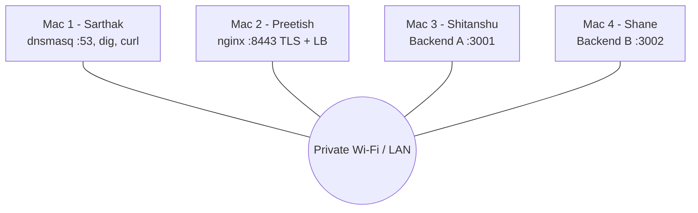
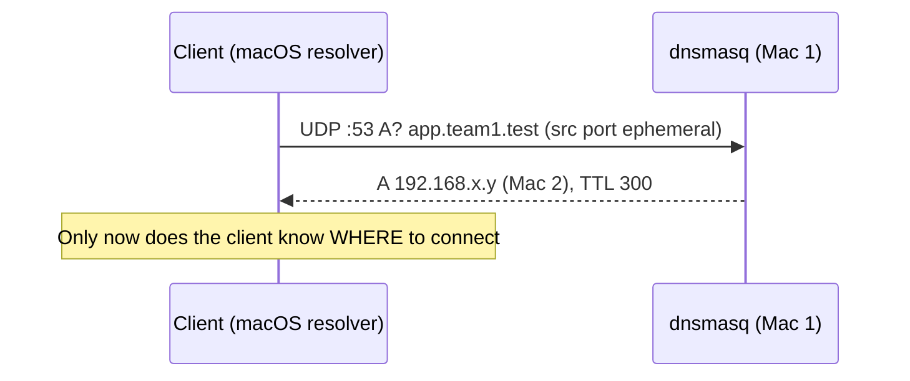
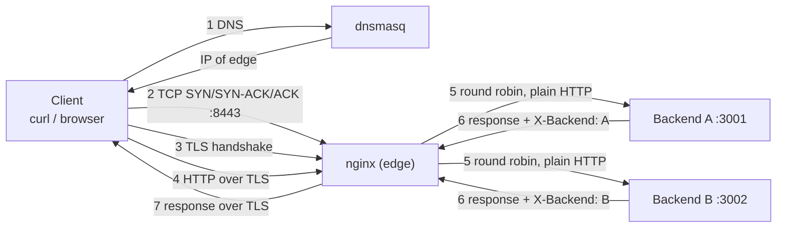
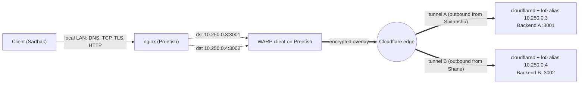
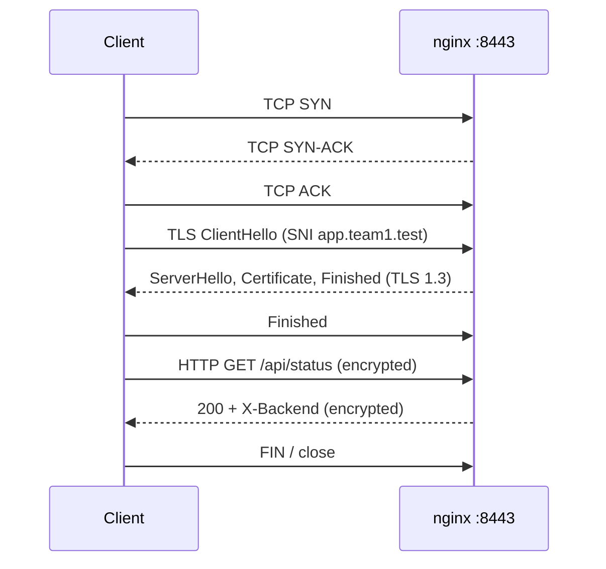
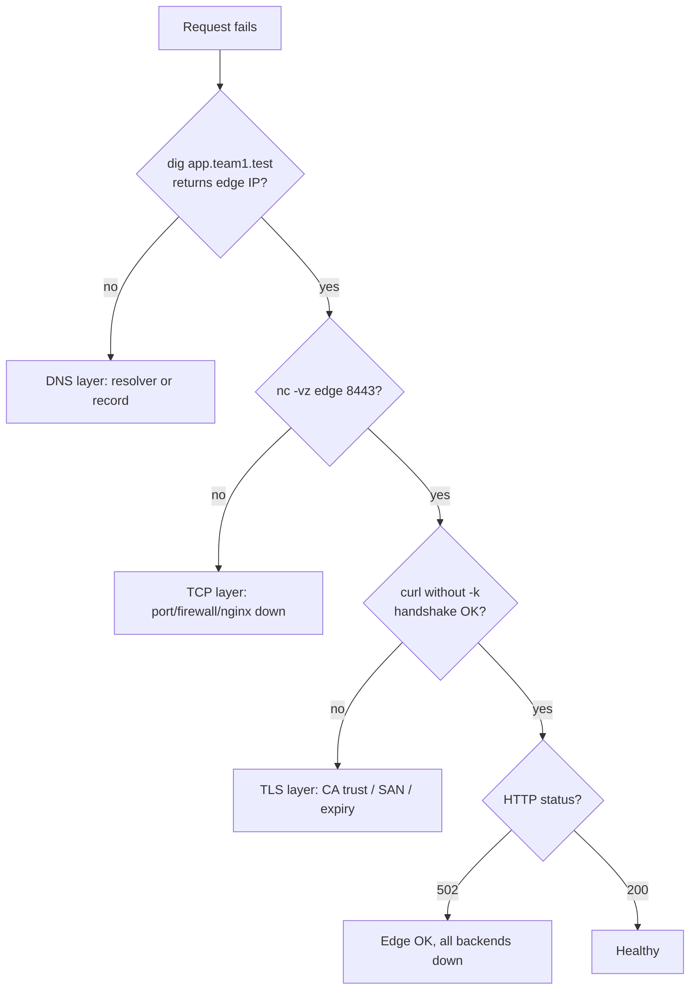
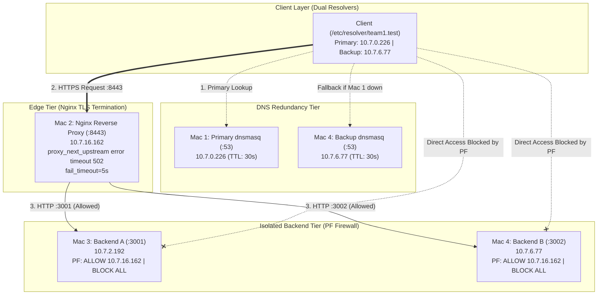
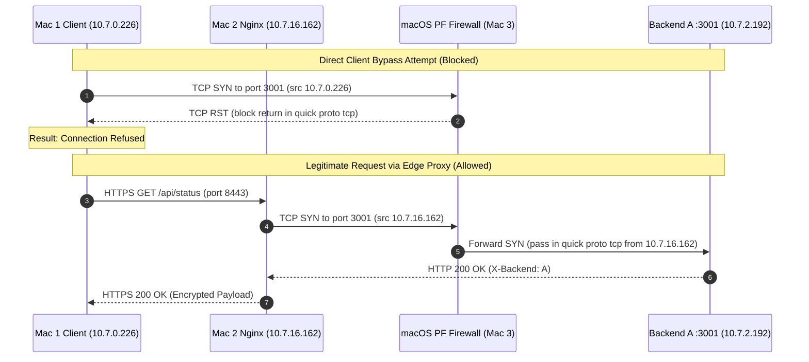

# Diagrams (Mermaid)

## 1. Machine topology (LAN mode)

## 2. DNS request

## 3. Full HTTP request path

## 4. Tunnel-mode path

## 5. TCP / TLS / HTTP sequence

## 6. Failure isolation

## 7. Phase 2 Resilient Topology & Dual DNS

## 8. Service Isolation Protocol Flow (Extension C)

